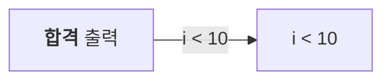
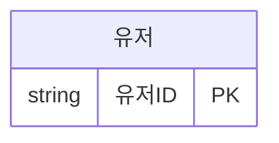

# meta-mermaid

Mermaid를 사용자가 정한 한 가지 모양으로 그린다.
디자인은 2026-10-08 시안 3개(A 도면형 · B 선만 · C 반전 머리) 중 B 선만을 세 번 고쳐 승인받은 것이다.
같은 질문을 다시 하지 않는 것이 이 스킬의 목적이다.
아래 정해진 것은 묻지 말고 적용한다.
사용자가 먼저 바꾸자고 할 때만 바꾼다(그때는 assets/web/theme.ts와, 그 값을 쓰는 프로젝트의 디자인 스펙을 함께).

## 기본 출력과 이미지 생성

- Mermaid를 처음 사용할 때는 문서의 ```mermaid 코드 블록이나 웹 화면의 도식으로 제공한다. PNG를 자동으로 생성하지 않는다.
- 사용자가 PNG 또는 이미지 파일로 뽑아 달라고 명시적으로 요청한 경우에만 그림 파일 렌더링을 실행한다. SVG도 사용자가 요청한 경우에만 생성한다.
- PNG 생성 여부를 먼저 묻지 않는다. 요청이 없으면 Mermaid 코드 블록을 유지한다.
- 원고 · 교재 · 책 · 블로그 · 강의 자료에 쓰인다는 이유만으로 이미지 파일을 만들거나 코드 블록을 이미지 링크로 바꾸지 않는다.
- 시나리오로 나눌지 판단할 때는 --format none으로 재기만 한다. 그림 파일이 생기지 않으므로 요청 없이 해도 된다.

결정 과정 · 이유 · 시안 기록은 references/design.md에 있다.
왜 이런 규칙인지 궁금할 때만 읽는다.

## 프로젝트 디자인 먼저 확인

그리기 전에 프로젝트가 도식 모양을 적어 두었는지 본다.

- CLAUDE.md, 디자인 스펙 문서에 mermaid나 도식의 테마 · 색 · 글꼴 규칙이 있다
- 코드에 mermaid.initialize의 theme · themeVariables 설정이 있다

있으면 아래 정해진 것 표 대신 프로젝트 것을 따른다.
render.mjs는 이 디자인으로만 그리므로 쓰지 않고 프로젝트의 그리는 방식을 쓴다.
Mermaid 다이어그램 작성 규칙과 Mermaid 문법과 배치 절은 그대로 지킨다.
없으면 묻지 않고 이 스킬의 모양을 쓴다.

## 정해진 것 (묻지 않는다)

| 항목 | 값 |
|---|---|
| 모양 | 채움 없음 · 흰 바탕 · 검정 글자(#111111) · 검정 1px 선 · 모서리 4px |
| 글꼴 | mono(Cascadia Mono → Consolas → Pretendard) 14px. 한글은 Pretendard로 |
| 굵게(700) | 제목(ER 엔티티 이름 · 순서도 참여자 · 묶음 제목), ER의 PK 줄(이름 · 키 칸), 라벨 안 굵게 표시 |
| Git 가지 | 회색 단계(#111 · #555 · #8a8a8a · #c4c4c4) |
| 폭 | 그림이 들어갈 글 폭 하나. 웹 읽는 글 760px(기본), 책은 판면 폭. 도식만 더 넓히지 않는다 |
| 가로 스크롤 | 없음 (책에도 넣어야 하므로) |
| 흐름 도식 선 | 되돌아가는 선이 없으면 직각 배치(ELK). 가로 · 세로 선분으로만 꺾고 곡선 · 사선 없음. 마주 보는 두 도형 사이 선은 꺾임 없는 직선, 짧은 계단(12px 미만) 없음. 마름모는 꼭짓점에서만 선이 나고 듦. 같은 두 도형 사이 글자 달린 선이 여럿이라 곧게 펴면 글자가 겹치면, 그 선들은 배치기가 잡아 둔 글자 자리로 꺾어 지나감(선 글자끼리 · 선과 글자가 겹치지 않음) |
| 되돌아가는 선 | 흐름 도식에 순환(재시도 · 다시 입력)이 있으면 dagre 곡선으로 그린다. ELK는 순환이 있으면 시작 도형을 잘못 골라 읽는 순서가 깨진다 |
| 세 노드 순환 | A → B → C → A 한 바퀴뿐인 가로 흐름도 · 가로 상태도는 앞으로 가는 둘을 일자로 놓고, 돌아가는 선은 그림 아래로 돌려 그린다. 한 줄에 한 선씩 쓴 글만 알아본다 |
| 배치 순서 | 원래 크기로 들어가면 그대로 → 넘치면 도형 간격 · 여백을 좁히고 폭에 맞게 줄임(글자 11px 이상. ELK는 간격 기준값 40 → 20) → 그래도 작아지면 갈래 없는 한 줄 흐름은 줄바꿈 배치(줄마다 가로, 윗줄 마지막 도형 아래 → 다음 줄 첫 도형 위로 꺾인 선) → 그 밖은 세로(TB) |
| ER · 상태도 | 방향을 적지 않으면 가로(LR)로. 관계선이 겹치지 않게(기본 배치기 dagre. ER · 상태도에 ELK는 선이 상자에 붙어서 안 씀. ELK는 흐름 도식만) |
| ER 관계선 글자 | 그리지 않음(쓴다 · 팔린다 등). 렌더러가 관계 줄 글자를 비운다. 흐름도 선 글자(예 · 아니오)는 그대로 |
| 원래 크기보다 키우기 | 하지 않음 |
| 도식 글 안 설정 | %%{init}%% · frontmatter config(테마 · 색 · 손그림 등)는 무시. frontmatter title만 남긴다 |
| 안전 | securityLevel strict. 라벨 안 HTML · 스크립트는 실행되지 않는다 |
| mermaid 판 | 11.17.2 · @mermaid-js/layout-elk 0.2.3 · elkjs 0.9.3 고정(12.x는 확인 전) |

## Mermaid 다이어그램 작성 규칙

### 1. 표현 목적에 따라 다이어그램 선택

- 처리 절차·실행 순서 설명 → flowchart LR 우선
- 실제 상태와 상태 전이가 학습목표 → stateDiagram-v2 허용
- 반복·조건 분기가 핵심 → 판단 노드와 순환선 유지
- 상태도라는 이유만으로 무조건 흐름도로 바꾸지 않는다.

### 2. 한 장으로 재 보고 나눌지 정한다

나누는 목적은 책에서 한눈에 읽히는 그림이다.
눈대중으로 정하지 않고 렌더 결과로 정한다.

| 순서 | 할 일 |
|---|---|
| 한 장으로 쓴다 | 처음은 늘 통합 그림 하나 |
| 잰다 | render.mjs --format none. 아래 하나라도 맞으면 나눈다. height가 width보다 크다. fontPx가 11 미만. 선이나 글자가 겹친다(의심되면 사용자에게 보일 그림으로 확인) |
| 나눈다 | 끝나는 곳 기준으로 시나리오를 나눈다(완료 · 실패, 계속 · 종료). 가장 단순한 정상 흐름이 먼저다 |
| 다시 잰다 | 시나리오마다 가로로 들어가야 한다(layout base · compact). 아니면 더 나눈다 |
| 통합 그림 | 처음 잰 결과에 문제가 없을 때만 함께 둔다. 문제가 있었으면 시나리오 그림만 둔다 |

- ERD · 순서도 · Git 그래프는 시나리오로 나누지 않는다. fontPx가 11 미만이면 둘로 쪼개자고 제안한다
- 나눈 그림에도 그 시나리오의 되돌아가는 선은 그대로 둔다
- 상태도를 나눌 때도 stateDiagram-v2를 유지한다. 실패 때만 재시작하면 실패 그림에만 재시작 지점으로 돌아가는 전이를 둔다
- 반복문은 조건이 예인 반복 시나리오와 아니오인 종료 시나리오로 나눈다. 처리 · 증가 · 조건 확인 순서는 실제 반복문을 따른다
- 그림 제목이나 설명에 시나리오와 분기 조건을 적는다. 같은 조건 · 상태 이름은 그림 사이에서 똑같이 쓴다

### 3. 순환선 사용 기준

- 시나리오를 나눠도 실패 후 재시작·반복 처리 후 조건 확인 등 실제로 되돌아가는 경로는 전이 화살표로 표시한다. 돌아갈 상태나 판단 노드에 정확히 연결한다.
- 반복문·Retry·폴링 등 순환 자체가 핵심이면 순환선을 유지한다. 반복 그림에는 복귀 화살표를 두고, 종료 그림에는 복귀 화살표를 두지 않는다.
- 재요청 등 부수적인 반복은 문장으로 설명할 수 있지만, 해당 그림의 시나리오가 재시작·재시도를 설명한다면 화살표를 유지한다.
- 순환선을 제거해서 실행 순서나 의미가 달라지면 안 된다.

### 4. 공통 디자인

- 기본 방향은 flowchart LR로 한다.
- 흐름이 길거나 복잡하면 flowchart TD를 허용한다.
- 학습자가 이해하기 쉬운 짧은 한글 노드 이름을 사용한다.
- 불필요한 교차선과 장식은 최소화한다.
- 하나의 그림에는 가능한 한 하나의 핵심 메시지만 담는다.

### 5. 최종 검증

- 중요한 상태·분기·반복·예외가 누락되지 않았는가?
- 그림만 봐도 실행 순서를 잘못 이해하지 않는가?
- 그림을 나누는 것이 이해에 실제로 도움이 되는가?
- 나눈 그림 전체에서 주요 시나리오와 분기 조건이 빠짐없이 설명되는가?
- 재시작·반복 화살표가 실제 복귀 지점으로 연결되고, 완료·종료 경로에는 불필요한 복귀가 없는가?

## Mermaid 문법과 배치

원고나 문서에 Mermaid를 직접 쓸 때 지키면 위 규칙대로 잘 나온다.
이유를 알면 예외 상황에서도 판단할 수 있어 함께 적는다.

- 종류는 위 작성 규칙의 표현 목적에 따라 고른다. 주고받기는 sequenceDiagram, 테이블 관계는 erDiagram, 브랜치 · 병합은 gitGraph를 쓴다. 분기나 반복이 있다는 이유만으로 TD를 강제하지 않는다.
- 단계 흐름은 LR을 우선한다. 길거나 복잡하면 TD를 쓸 수 있다. LR의 갈래 없는 한 줄 흐름이 폭을 넘으면 렌더러가 줄을 바꿔 배치한다. 방향을 바꿔도 중요한 분기와 순환선은 유지한다.
- ER · 상태도는 direction을 쓰지 않는다. 렌더러가 가로로 놓고, 넘치면 알아서 줄인다
- ER 관계 줄은 글자를 비워 쓴다(유저 ||--o{ 주문 : ""). 써도 렌더러가 지운다
- 색 · 테마 · classDef · style · linkStyle · %%{init}%%를 쓰지 않는다. 테마는 어차피 무시된다. classDef · style이 있으면 한 줄 흐름이 줄바꿈 대상에서 빠져 세로가 된다
- 중요한 글자만 굵게 한다. 백틱으로 감싼 Markdown 글에 별표 둘을 쓴다(아래 예). 남용하면 강조가 사라진다. ER은 기본 키 줄에 PK를 달면 자동으로 굵다
- 라벨은 짧게 쓴다. 한 도형에 한 줄, 한글 12자 안팎. 길면 도형이 넓어져 줄어드는 비율이 커지고 글자가 작아진다
- 특수 글자가 있는 라벨은 큰따옴표로 감싼다. 따옴표 자체는 #quot;
- 같은 두 도형 사이 선은 적게 둔다. 글자 달린 선이 셋 이상이면 곧게 못 펴고 꺾여 지나간다. 읽기 어려우면 한 선 글자로 합치거나(검사 통과 · 취소) 도형을 나눈다
- 엔티티 · 노드 이름, 속성 이름은 한글로 써도 된다





## 그림 파일로 만들기 (원고 · 책 · 블로그)

사용자가 그림 파일 생성을 명시적으로 요청했을 때만 이 절을 실행한다.
처음 Mermaid를 사용하거나 코드 블록을 작성하는 단계에서는 실행하지 않는다.
아래 --format의 기본값 png는 사용자가 요청해서 렌더러를 실행할 때의 파일 형식이다. 자동 생성 지침이 아니다.
재기만 하는 --format none은 예외다(작성 규칙 2).

scripts/render.mjs가 웹 화면과 같은 코드로 그린다.
scripts/browser.ts가 assets/web/의 TS 파일을 불러 쓴다.
render.mjs가 처음 실행 때와 그 파일들이 바뀌었을 때 esbuild로 scripts/.build/browser.js 하나로 묶는다.
배치 · 모양을 고칠 때는 assets/web/만 고친다(웹 화면 · 그림 파일이 함께 바뀐다).

처음 한 번만 이 스킬 폴더에서 설치한다.

```bash
cd ~/.claude/skills/meta-mermaid && npm install && npx playwright install chromium
```

그리기

```bash
# MD 원고: ```mermaid 블록마다 그림 + 블록을 그림 링크로 바꾼 MD
node ~/.claude/skills/meta-mermaid/scripts/render.mjs 원고.md --md-out 원고.rendered.md

# 도식 하나(.mmd)
node ~/.claude/skills/meta-mermaid/scripts/render.mjs 구조.mmd --format both
```

| 옵션 | 기본 | 뜻 |
|---|---|---|
| --width | 760 | 그림이 들어갈 폭(px). 책이면 판면 폭(예: 150mm 판면 ≈ 567px@96dpi) |
| --format | png | png · svg · both · none. 책 · 문서 도구는 PNG가 안전(SVG는 라벨이 foreignObject HTML이라 일부 도구가 못 그림). none은 파일 없이 재기만 한다 |
| --scale | 2 | PNG 배율(인쇄용이면 3~4) |
| --out | 원고이름-diagrams/ | 그림 폴더 |
| --md-out | 없음 | 주면 블록을 그림 링크로 바꾼 MD를 쓴다. 원본 MD는 고치지 않는다 |

결과는 도식마다 JSON 한 줄이다.
layout(base · compact · wrap · flip), scale, fontPx, width · height(들어갈 크기), files 또는 error가 들어 있다.
그다음 할 일

- PNG를 생성했다면 직접 열어 본다. 숫자가 맞아도 라벨이 잘리거나 선이 겹칠 수 있다. 사용자에게 보이기 전에 본다. 검증을 위해 요청하지 않은 PNG를 추가로 생성하지 않는다.
- error가 있으면 그 블록은 MD에 그대로 남는다. 문법을 고쳐 다시 그린다(흔한 원인은 연결선 끝 노드 빠짐, 라벨 안 따옴표)
- fontPx가 11보다 작으면(순서도 · Git처럼 세로로 바꿀 수 없는 종류가 아주 넓을 때) 도식을 둘로 나누거나 참여자 · 커밋을 줄이자고 제안한다

## 웹 앱 화면에 넣기

React 앱이면 assets/web/의 파일을 가져다 쓴다.
이 스킬이 원본이다.
프로젝트에 복사해 쓰고, 고칠 때는 여기와 프로젝트를 함께 맞춘다.
그림 품질은 render.mjs와 같다.

- theme.ts는 값과 mermaid 설정(DIAGRAM_CONFIG, secure 잠금 포함)
- layout.ts는 배치 규칙(layoutDiagram, 순환 없는 흐름 도식만 layout elk), PK 굵게(emphasizeKeys), 줄바꿈 연결선(drawReturns), 세 노드 순환의 돌아가는 선(drawCycleReturn)
- elk-adjust.ts는 흐름 도식 직각 배치 고침(마름모 꼭짓점 · 마주 보는 선 펴기 · 짧은 계단 없애기 · 글자 겹침 피하기 · 줄일 때 간격 좁히기). installElkAdjust(ELK)로 elkjs의 layout()을 감싼다
- Diagram.tsx는 읽는 글 폭을 ResizeObserver로 재고(바뀌면 150ms 멈춘 뒤 한 번), 쓰는 중이 아닐 때 그린다. 실패하면 원래 코드 블록과 "도식을 그리지 못했습니다"
- diagram.css는 가로 스크롤 없이 폭에 맞춰 줄이는 CSS. 클래스는 mermaid-diagram. 토큰(--space-* 등)은 기본값이 붙어 있고, 프로젝트 토큰이 있으면 그 이름으로 바꾼다

연결 방법

- Markdown 렌더러의 코드 블록이 language-mermaid이고 글이 다 생긴 뒤면 Diagram에 code와 fallback(원래 코드 블록)을 넘긴다
- mermaid · layout-elk · elkjs는 Diagram.tsx의 load()가 늦게 불러 첫 화면 번들에서 뺀다
- 의존성은 mermaid@11.17.2 · @mermaid-js/layout-elk@0.2.3 · elkjs@0.9.3. elk-adjust가 감싸는 ELK와 layout-elk가 쓰는 ELK가 같은 모듈이어야 한다
